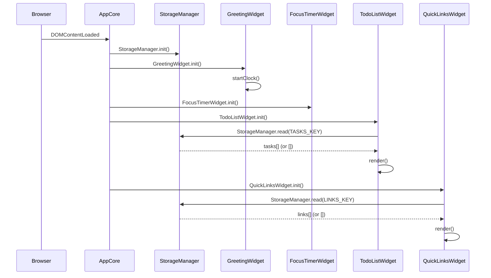

# Design Document

## Life Dashboard

---

## Overview

The Life Dashboard is a client-side, single-page web application that runs entirely in the browser with no backend. It is distributed as three static files: `index.html`, `css/style.css`, and `js/app.js`. All persistent state lives in the browser's `localStorage`. The app must work in the current stable release of Chrome, Firefox, Edge, and Safari without polyfills.

The design is organized around four independent **widgets**, each responsible for its own DOM subtree, state, and storage key. A thin **AppCore** module handles initialization order, global error boundaries, and storage I/O so that each widget only needs to call `Storage.read()` / `Storage.write()` rather than touching `localStorage` directly.

### Design Goals

- **Zero dependencies** — Vanilla JS (ES2020), no frameworks, no build tools.
- **Separation of concerns** — each widget is a self-contained module in `js/app.js` (ES module IIFE pattern).
- **Resilience** — storage failures surface a user-visible warning but never crash the app.
- **Accessibility** — WCAG 2.1 AA color contrast; ARIA roles and labels on interactive controls.

---

## Architecture

### High-Level Module Structure

```
js/app.js
│
├── StorageManager          — thin wrapper around localStorage (read / write / error handling)
│
├── GreetingWidget          — time, date, greeting; owns #greeting-section
├── FocusTimerWidget        — countdown timer; owns #timer-section
├── TodoListWidget          — task CRUD + persistence; owns #todo-section
├── QuickLinksWidget        — link CRUD + persistence; owns #links-section
│
└── AppCore.init()          — calls each widget's init() in order, after DOM ready
```

All four widgets follow the same lifecycle contract:

```
WidgetName.init()   → read storage, render initial DOM, attach event listeners
WidgetName.render() → rebuild/update the widget's DOM subtree from in-memory state
```

No widget communicates with another widget; all shared concerns go through `StorageManager`.

### Initialization Sequence



### File Layout

```
index.html          — semantic HTML shell; four <section> landmark elements
css/style.css       — all styling; CSS custom properties for theming
js/app.js           — all logic; IIFE modules; no imports/exports (single-file constraint)
```

---

## Components and Interfaces

### StorageManager

Responsible for all `localStorage` access. Isolates error handling so widgets never need try/catch.

```
StorageManager = {
  TASKS_KEY: 'lifeDashboard_tasks',
  LINKS_KEY: 'lifeDashboard_links',

  read(key) → Array<object> | []
    // Reads JSON from localStorage[key].
    // Returns [] on missing key, invalid JSON, or storage error.
    // Shows global warning banner on error.

  write(key, data) → boolean
    // Serializes data to JSON, writes to localStorage[key].
    // Returns true on success, false on error.
    // Shows global warning banner on error.
}
```

**Storage key design**: Two distinct keys (`lifeDashboard_tasks`, `lifeDashboard_links`) prevent collisions. Both keys are prefixed to avoid clashing with other apps on the same origin.

---

### GreetingWidget

Owns `<section id="greeting-section">`. Renders time, date, and greeting. Updates on a 1-second interval; only touches the DOM when the displayed value would change.

**Key functions:**

```
GreetingWidget = {
  init()
    // Renders immediately, then calls startClock().

  startClock()
    // setInterval(tick, 1000)

  tick()
    // Gets current Date, computes time string, date string, and greeting.
    // Calls renderTime(), renderDate(), renderGreeting() only when values differ.

  getGreeting(hour: number) → string
    // hour 05–11 → "Good Morning"
    // hour 12–17 → "Good Afternoon"
    // hour 18–21 → "Good Evening"
    // hour 22–23, 00–04 → "Good Night"

  formatTime(date: Date) → string   // "HH:MM"
  formatDate(date: Date) → string   // "Day-of-Week, DD Month YYYY"
}
```

---

### FocusTimerWidget

Owns `<section id="timer-section">`. Manages a 25-minute countdown with Start, Stop, and Reset controls. State is kept in memory only (no persistence needed per requirements).

**State:**

```
timerState = {
  totalSeconds: number,   // remaining seconds; initial value = 1500 (25 × 60)
  intervalId:   number | null,
  isRunning:    boolean
}
```

**Key functions:**

```
FocusTimerWidget = {
  init()          // renders initial 25:00, attaches button listeners

  start()         // sets intervalId = setInterval(tick, 1000); updates button states
  stop()          // clearInterval(intervalId); updates button states
  reset()         // stop(); totalSeconds = 1500; render()

  tick()
    // totalSeconds -= 1
    // if totalSeconds <= 0: stop(), showTimesUp()
    // else: renderDisplay()

  renderDisplay()           // formats totalSeconds → "MM:SS", updates DOM
  updateButtonStates()      // disables/enables Start, Stop per isRunning
  showTimesUp()             // renders "Time's up!" message; hides after 5 s
  formatCountdown(s) → string  // seconds → "MM:SS"
}
```

**Button state matrix:**

| State          | Start   | Stop    | Reset   |
|----------------|---------|---------|---------|
| Idle (initial) | enabled | disabled| enabled |
| Running        | disabled| enabled | enabled |
| Paused         | enabled | disabled| enabled |
| Expired        | enabled | disabled| enabled |

---

### TodoListWidget

Owns `<section id="todo-section">`. Manages an in-memory array of Task objects, renders them, and persists to `StorageManager` on every mutation.

**State:**

```
tasks: Array<Task>   // in-memory copy; source of truth for rendering
editingId: string | null  // id of the task currently in edit mode (null = none)
```

**Key functions:**

```
TodoListWidget = {
  init()          // reads tasks from StorageManager, calls render()

  addTask(description: string) → void
    // Validates (non-empty, trimmed, ≤ 500 chars)
    // Creates Task with generateId(), appends to tasks[], persists, render()

  toggleComplete(id: string) → void
    // Flips task.completed, persists, render()

  startEdit(id: string) → void
    // Sets editingId = id, render() (renders editable field)

  confirmEdit(id: string, newText: string) → void
    // If newText trimmed empty → cancelEdit()
    // Else updates task.text, editingId = null, persists, render()

  cancelEdit() → void
    // editingId = null, render()

  deleteTask(id: string) → void
    // Removes task from array, persists, render()

  render() → void
    // Rebuilds #todo-list from tasks[] and editingId

  persist() → void
    // StorageManager.write(TASKS_KEY, tasks)

  generateId() → string   // crypto.randomUUID() with Date.now() fallback
}
```

---

### QuickLinksWidget

Owns `<section id="links-section">`. Manages an in-memory array of Link objects, renders them as clickable buttons, and persists to `StorageManager`.

**State:**

```
links: Array<Link>   // in-memory copy
```

**Key functions:**

```
QuickLinksWidget = {
  init()           // reads links from StorageManager, render()

  addLink(label: string, url: string) → void
    // Validates: non-empty label (≤ 50 chars), non-empty URL starting with http:// or https://
    // Enforces 20-link cap
    // Appends Link, persists, render()

  deleteLink(id: string) → void
    // Removes link, persists, render()

  render() → void
    // Rebuilds #links-grid from links[]

  persist() → void
    // StorageManager.write(LINKS_KEY, links)

  validateUrl(url: string) → boolean
    // Returns true if url.startsWith('http://') || url.startsWith('https://')
}
```

---

## Data Models

### Task

```js
{
  id:        string,   // unique identifier (UUID or timestamp-based)
  text:      string,   // 1–500 characters, trimmed
  completed: boolean,  // false when first created
  createdAt: number    // Date.now() timestamp, for stable ordering
}
```

**Storage key:** `lifeDashboard_tasks`
**Stored format:** `JSON.stringify(Array<Task>)`

---

### Link

```js
{
  id:    string,   // unique identifier
  label: string,   // 1–50 characters, trimmed
  url:   string    // must start with "http://" or "https://"; max 2048 characters
}
```

**Storage key:** `lifeDashboard_links`
**Stored format:** `JSON.stringify(Array<Link>)`

---

### Storage Schema Summary

| Key                    | Value type        | Max items |
|------------------------|-------------------|-----------|
| `lifeDashboard_tasks`  | `JSON<Task[]>`    | Unlimited |
| `lifeDashboard_links`  | `JSON<Link[]>`    | 20        |

---

## Correctness Properties

*A property is a characteristic or behavior that should hold true across all valid executions of a system — essentially, a formal statement about what the system should do. Properties serve as the bridge between human-readable specifications and machine-verifiable correctness guarantees.*

### Property 1: Greeting maps every hour to exactly one greeting

*For any* hour value in the range 0–23, `GreetingWidget.getGreeting(hour)` SHALL return exactly one of {"Good Morning", "Good Afternoon", "Good Evening", "Good Night"}, and the four greeting ranges SHALL partition the full 24-hour clock with no gaps and no overlaps.

**Validates: Requirements 1.3, 1.4, 1.5, 1.6**

---

### Property 2: Time format always produces HH:MM

*For any* `Date` object, `GreetingWidget.formatTime(date)` SHALL return a string that matches the regular expression `^\d{2}:\d{2}$` with hours in [00, 23] and minutes in [00, 59].

**Validates: Requirements 1.1**

---

### Property 3: Date format always produces the canonical pattern

*For any* `Date` object, `GreetingWidget.formatDate(date)` SHALL return a string matching `^[A-Za-z]+, \d{2} [A-Za-z]+ \d{4}$` (e.g., "Monday, 12 October 2026").

**Validates: Requirements 1.2**

---

### Property 4: Timer countdown format always produces MM:SS

*For any* integer `s` in [0, 1500], `FocusTimerWidget.formatCountdown(s)` SHALL return a string matching `^\d{2}:\d{2}$` with minutes in [00, 25] and seconds in [00, 59].

**Validates: Requirements 2.2, 2.8**

---

### Property 5: Adding a task grows the list by exactly one

*For any* task list state and any valid (non-empty, non-whitespace-only) task description of 1–500 characters, calling `TodoListWidget.addTask(description)` SHALL increase `tasks.length` by exactly 1 and the new task SHALL appear at the end of the array with `completed = false`.

**Validates: Requirements 3.1, 3.3**

---

### Property 6: Whitespace-only descriptions are always rejected

*For any* string composed entirely of whitespace characters (space, tab, newline, etc.), `TodoListWidget.addTask(description)` SHALL NOT append any task to the list, and `tasks.length` SHALL remain unchanged.

**Validates: Requirements 3.2**

---

### Property 7: Task serialization round-trip preserves data

*For any* array of Task objects, serializing to JSON via `JSON.stringify` and then deserializing via `JSON.parse` SHALL produce an array that is deeply equal to the original (same `id`, `text`, `completed`, `createdAt` values for every element).

**Validates: Requirements 5.2, 5.3**

---

### Property 8: Toggling completion twice restores original state

*For any* task in the list, calling `toggleComplete(id)` twice SHALL leave `task.completed` equal to its original value (idempotence of double-toggle).

**Validates: Requirements 3.5**

---

### Property 9: Link URL validation enforces scheme prefix

*For any* string, `QuickLinksWidget.validateUrl(url)` SHALL return `true` if and only if `url` starts with `"http://"` or `"https://"` (case-sensitive). All other strings — including empty strings, relative paths, `ftp://`, `//`, or `javascript:` — SHALL return `false`.

**Validates: Requirements 4.3**

---

### Property 10: Link collection never exceeds 20 items

*For any* link list of length 20, calling `addLink(label, url)` with any valid label and URL SHALL NOT append the link to the list, `links.length` SHALL remain 20, and an inline rejection message SHALL be produced.

**Validates: Requirements 4.10**

---

### Property 11: Link serialization round-trip preserves data

*For any* array of Link objects, serializing to JSON via `JSON.stringify` and then deserializing via `JSON.parse` SHALL produce an array that is deeply equal to the original (same `id`, `label`, `url` values for every element).

**Validates: Requirements 5.2, 5.3**

---

## Error Handling

### Storage Failures

`StorageManager.read()` and `StorageManager.write()` are wrapped in `try/catch`. On any error:

- A non-blocking **warning banner** (`role="alert"`, `aria-live="polite"`) is inserted at the top of the page.
- The calling widget continues operating with its current in-memory state (no crash, no data loss in the current session).
- The banner can be dismissed by the user.

**Scenarios covered:**

| Scenario | Behaviour |
|---|---|
| `localStorage` throws `SecurityError` or `QuotaExceededError` on write | Warning shown; in-memory state retained |
| Stored value is not valid JSON on read | `read()` returns `[]`; warning shown |
| Storage unavailable entirely on load | Each widget renders empty; warning shown |

### Validation Failures

| Widget | Invalid input | Behaviour |
|---|---|---|
| TodoListWidget | Empty / whitespace-only description | Inline `<p role="alert">` under the input field; focus returned to field |
| TodoListWidget | Description > 500 chars | Inline validation message |
| QuickLinksWidget | Empty label or empty URL | Inline message identifying missing field |
| QuickLinksWidget | URL missing http/https scheme | Inline message with scheme requirement |
| QuickLinksWidget | 20 links already saved | Inline message indicating limit reached |

### Timer Edge Cases

- `tick()` guards `totalSeconds` against going below 0: `totalSeconds = Math.max(0, totalSeconds - 1)`.
- Multiple rapid clicks on Start are no-ops if `isRunning === true` (button is disabled anyway).
- `reset()` always calls `clearInterval()` before resetting state to avoid orphaned intervals.

### Widget Render Failure

If `render()` throws an unhandled exception, `AppCore` catches it and inserts a placeholder `<div>` of the same minimum height so the layout does not collapse (Requirement 6.8).

---

## Testing Strategy

### Unit Tests (Example-Based)

Each widget's pure functions are tested with specific, concrete inputs:

| Function | Example inputs to cover |
|---|---|
| `getGreeting(hour)` | Boundary hours: 5, 11, 12, 17, 18, 21, 22, 23, 0, 4 |
| `formatTime(date)` | Midnight (00:00), noon (12:00), last-minute-of-day (23:59) |
| `formatDate(date)` | First of January, last of December, leap-day |
| `formatCountdown(s)` | 1500 (25:00), 0 (00:00), 59 (00:59), 60 (01:00) |
| `validateUrl(url)` | `"http://a.com"`, `"https://b.io"`, `""`, `"ftp://c"`, `"//d"` |
| Storage error handling | Mock `localStorage` to throw `QuotaExceededError` on write |

### Property-Based Tests

Property-based testing is appropriate for this feature because it involves pure transformation functions (time formatting, URL validation, JSON serialization) and data-structure invariants (list length, completion toggling) where input variation across a large space reveals edge cases that example-based tests miss.

**Library:** [fast-check](https://github.com/dubzzz/fast-check) (JavaScript PBT library)

Each property test MUST run a minimum of **100 iterations**.

Each test MUST be tagged with a comment:
`// Feature: life-dashboard, Property <N>: <property_text>`

| Property | Test description | Generators |
|---|---|---|
| P1 — Greeting coverage | `fc.integer({min:0,max:23})` → assert result ∈ valid set, full partition | `fc.integer({min:0, max:23})` |
| P2 — Time format | `fc.date()` → assert `formatTime` matches `HH:MM` regex | `fc.date()` |
| P3 — Date format | `fc.date()` → assert `formatDate` matches canonical pattern regex | `fc.date()` |
| P4 — Countdown format | `fc.integer({min:0,max:1500})` → assert `formatCountdown` matches `MM:SS` | `fc.integer({min:0, max:1500})` |
| P5 — Task addition grows list | `fc.array(taskArb)` + `fc.string({minLength:1})` → assert length +1, tail = new task | Custom `taskArb` + `fc.string` |
| P6 — Whitespace rejected | `fc.stringMatching(/^\s+$/)` → assert list unchanged | `fc.stringMatching(/^\s+$/)` |
| P7 — Task round-trip | `fc.array(taskArb)` → assert `parse(stringify(arr))` deeply equals `arr` | Custom `taskArb` |
| P8 — Toggle idempotence | `fc.array(taskArb, {minLength:1})` → toggle twice → assert `.completed` unchanged | Custom `taskArb` |
| P9 — URL validation | `fc.string()` → assert `validateUrl` true iff starts with `http://` or `https://` | `fc.string()` |
| P10 — Link cap enforced | `fc.array(linkArb, {minLength:20,maxLength:20})` + valid link → assert length still 20 | Custom `linkArb` |
| P11 — Link round-trip | `fc.array(linkArb)` → assert `parse(stringify(arr))` deeply equals `arr` | Custom `linkArb` |

### Integration / Smoke Tests

- **Storage integration**: Load the page in a real browser (or jsdom), add tasks and links, reload, assert data survives.
- **Cross-browser smoke**: Automated Playwright tests on Chrome, Firefox, and WebKit to assert no JS errors on load, all four sections visible, timer counts down, task persists across reload.
- **Layout smoke**: Viewport at 320 px (mobile) and 1280 px (desktop); assert single-column vs. multi-column layout is applied.

### Accessibility Tests

- Run [axe-core](https://github.com/dequelabs/axe-core) against the rendered page to verify WCAG 2.1 AA color contrast and ARIA role correctness.
- Manual keyboard-navigation pass: Tab order reaches every interactive control; Enter/Space activates buttons.
